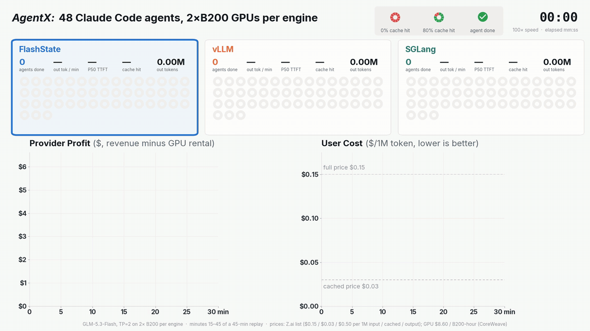
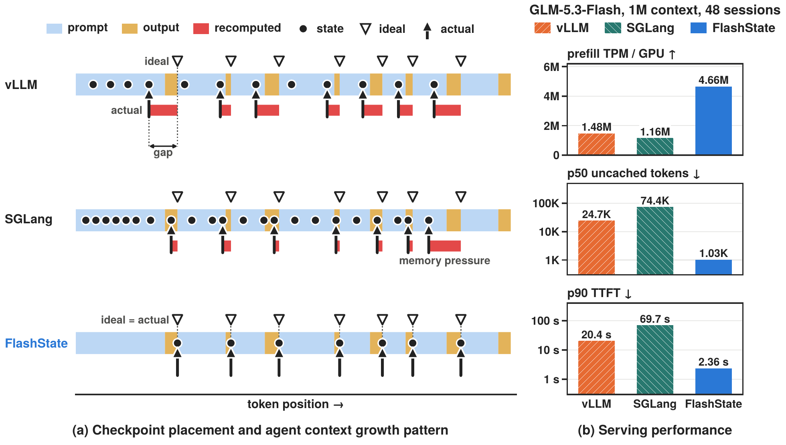
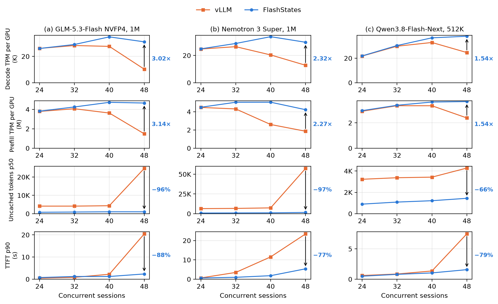
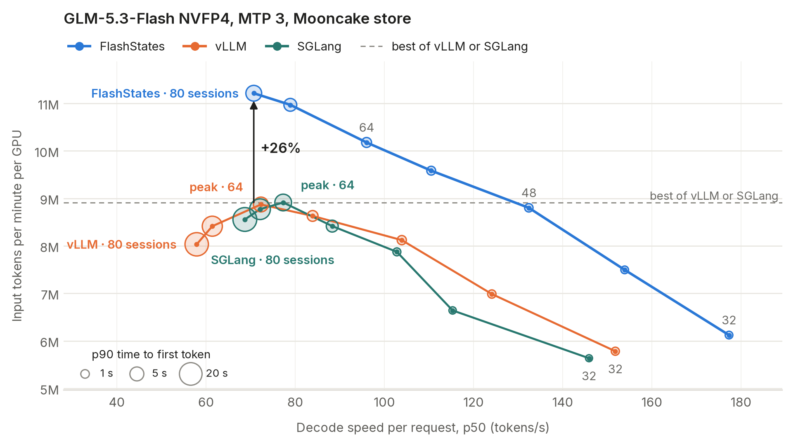
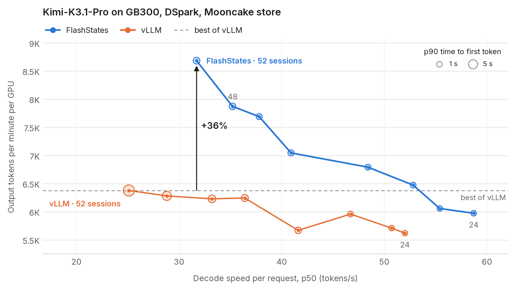

<!-- markdownlint-disable MD033 MD041 -->
<h1 align="center">FlashStates</h1>

<h3 align="center">
Unlocking Flexible Hybrid State Management for Agentic LLM Inference
</h3>

<p align="center">
  <a href="https://www.alphaxiv.org/abs/2611.flashstate"></a>
  <a href="https://flashstate.ai"></a>
  <a href="https://github.com/orgs/FutureMLS-Lab/packages?repo_name=FlashStates"></a>
  <a href="#citation"></a>
  <a href="LICENSE"></a>
</p>

---

## About

<p align="center">
  <a href="docs/demo/flashstate-48-agents.mp4"></a>
  <br>
  <em>48 coding agents on the same GPUs, replayed at 100× speed (GLM-5.3-Flash NVFP4, two B200 GPUs per engine). Each
  circle is one agent: green is prompt read from cache, red is recomputed. Click for the video with sound.</em>
</p>

Coding agents resend a growing context on every turn. On a hybrid model, which mixes attention with linear-attention
or state-space layers, a cached prefix is reusable only with its *hybrid state*: the attention KV of every token and a
*recurrent checkpoint* at the prefix's exact end. vLLM saves recurrent checkpoints only at KV-cache block boundaries
and evicts KV blocks by recency, so each turn recomputes the end of the previous one, and under load whole contexts.

FlashStates changes this with:

- **Arbitrary state checkpointing (ASC).** Recurrent checkpoints are saved at any token position: at the end of a
  prompt, inside a long prefill and at the end of a request. The next turn resumes exactly where the previous one
  ended.
- **Cost-aware hybrid state management.** A recurrent checkpoint and the KV blocks it needs are admitted and evicted
  together, by the prefill they save per block of cache. The policy needs no per-workload tuning.
- **A Mooncake store tier (optional).** Each finished request's hybrid state is written through to a Mooncake store in
  host memory, whose master evicts whole states by the same priority.

This repository holds:

- **FlashStates' vLLM** ([FutureMLS-Lab/vllm](https://github.com/FutureMLS-Lab/vllm/tree/flashstate), vLLM v0.33.0) and
  **FlashStates' Mooncake** ([FutureMLS-Lab/Mooncake](https://github.com/FutureMLS-Lab/Mooncake/tree/flashstate), Mooncake
  0.3.13.post1), as the submodules `third_party/vllm` and `third_party/mooncake`.
- **A B200 image for GLM-5.3-Flash NVFP4, Qwen3.8-Flash-Next FP8 and Nemotron 3 Super FP8** on the official
  `vllm/vllm-openai:v0.33.0` image ([how the image is built](docs/how-the-image-is-built.md)).
- **A GB300 image for Kimi-K3.1-Pro** on the official `vllm/vllm-openai:kimi-k31-cu134` image, with FlashStates' vLLM
  and Mooncake from the forks' `flashstate-k31pro-gb300` branches.
- **Benchmarks**: a closed-loop replay of public coding-agent traces against the official image, and the scripts that
  turn the runs into tables and figures.

### Overview

<p align="center">
  
</p>

(a) vLLM keeps recurrent checkpoints only at block boundaries, so each turn resumes from the last one before the end of
the previous turn and recomputes the rest (red). SGLang checkpoints more densely, but under memory pressure a turn can
fall back further. FlashStates checkpoints the exact end of each turn and resumes there.
(b) GLM-5.3-Flash at 48 concurrent sessions: FlashStates serves 3.1× vLLM's and 4.0× SGLang's prefill throughput per
GPU, with 24× fewer median uncached tokens and 88% lower p90 time to first token than vLLM.

### Results

On closed-loop replays of coding-agent sessions, with two B200 GPUs per server, FlashStates reaches up to **3.02×**
vLLM's decode throughput and **3.14×** its prefill throughput, and cuts the median uncached prompt tokens per request
by **96%** and p90 time to first token by **88%** (GLM-5.3-Flash at 48 concurrent sessions). With 512 GiB of host cache
per engine, its input throughput peaks **26%** above the best vLLM or SGLang run in the figure (24% above vLLM's best
measured run, at 60 sessions).

<p align="center">
  
  <br>
  <em>GPU only: three models at 24 to 48 concurrent sessions.</em>
</p>

<p align="center">
  
  <br>
  <em>GLM-5.3-Flash with 512 GiB of host memory for cache per engine (a Mooncake store for vLLM and FlashStates,
  HiCache's host tier for SGLang), 32 to 80 sessions; bubble area shows p90 time to first token.</em>
</p>

On Kimi-K3.1-Pro, one engine on two GB300 trays (eight GPUs, decode context parallelism 8) with DSpark speculative
decoding and a 640 GiB Mooncake store, FlashStates' output throughput per GPU peaks **36%** above vLLM's best (8,683
against 6,377 tokens per minute, both at 52 sessions), with a p90 time to first token of **2.0 s** against 9.1 s, over
minutes 15 to 45 of hour-long runs.

<p align="center">
  
  <br>
  <em>Kimi-K3.1-Pro on GB300 with a 640 GiB Mooncake store per engine, FlashStates and vLLM, 24 to 52 sessions in
  steps of 4; bubble area shows p90 time to first token.</em>
</p>

[`benchmarks/`](benchmarks/README.md) gives the setup, the metrics and the source of each figure's numbers, and reruns
every B200 configuration against the official image. Its tables list our reruns of the four B200 configurations
against the official `vllm/vllm-openai:v0.33.0` image (the three models with GPU memory only, and GLM-5.3-Flash with the
Mooncake store), and the Kimi-K3.1-Pro figure's points with their prefill throughput, median uncached tokens and cache
hit rate.

## Getting Started

### 1. Pull an image

| GPU | Models | Image |
|---|---|---|
| B200 | GLM-5.3-Flash, Qwen3.8-Flash-Next, Nemotron 3 Super | `ghcr.io/futuremls-lab/flashstates-b200:v0.1.0-b200` |
| GB300 | Kimi-K3.1-Pro | `ghcr.io/futuremls-lab/flashstates-gb300:v0.1.0-kimi-k31-gb300` |

The same images are on Docker Hub as `weili0234/flashstates-vllm`. The [v0.1.0 release](https://github.com/FutureMLS-Lab/FlashStates/releases/tag/v0.1.0) lists their full tags and digests. To build from source, see [docs/install.md](docs/install.md).

### 2. Serve a model

This serves GLM-5.3-Flash on two B200 GPUs:

```bash
docker run --rm --gpus '"device=0,1"' --ipc=host --network host \
    -v /models/glm53flash:/model:ro \
    ghcr.io/futuremls-lab/flashstates-b200:v0.1.0-b200 \
    vllm serve /model --tensor-parallel-size 2 --enable-prefix-caching \
    --mamba-frontier-checkpoint --mamba-prefill-export \
    --prefix-cache-eviction gds --prefill-cost-coefficients 1.862e-5 3.33e-6 \
    --prefix-cache-leaf-last --prefix-cache-leaf-idle-seconds 60
```

Clients use vLLM's OpenAI-compatible API unchanged. [docs/what-flashstate-changes.md](docs/what-flashstate-changes.md) explains each FlashStates flag. The prefill cost coefficients are per model, and [`benchmarks/configs/`](benchmarks/configs) has the settings for every model, with and without the Mooncake store. Kimi-K3.1-Pro runs on two GB300 nodes; see [its branch README](https://github.com/FutureMLS-Lab/vllm/blob/flashstate-k31pro-gb300/.github/README.md).

### 3. Reproduce a result

Each result point starts a fresh server, replays a fixed number of agent sessions, and writes the readings:

```bash
MODEL_DIR=/models/glm53flash HF_HOME=/data/hf GPUS=0,1 PORT=8000 \
    benchmarks/run_point.sh glm53flash-nvfp4-gpu flashstate 48 results/glm53flash-nvfp4-gpu/flashstate/48
```

A point takes about 50 minutes on GLM-5.3-Flash and about 80 minutes on the other models. [`benchmarks/README.md`](benchmarks/README.md) covers the traces, model revisions, baselines and tables.

## Repository layout

| Directory | What it contains |
|---|---|
| `third_party/vllm/` | FlashStates' vLLM: vLLM v0.33.0 plus FlashStates |
| `third_party/mooncake/` | FlashStates' Mooncake: Mooncake 0.3.13.post1 plus the store client and master changes |
| [`docker/`](docker) | The B200 image ([how it is built](docs/how-the-image-is-built.md)) |
| [`benchmarks/`](benchmarks/README.md) | Reproducibility scripts |
| [`analysis/`](analysis) | Readings, tables and figures from the runs |
| [`docs/`](docs) | [Install from source](docs/install.md), [what FlashStates changes](docs/what-flashstate-changes.md), [how the image is built](docs/how-the-image-is-built.md), the figures and their readings |

## Status

FlashStates is research code, and its options may change. The B200 results use two B200 GPUs per server, and
Kimi-K3.1-Pro one engine on two GB300 trays. On other GPUs, size the KV cache for the card.

## Citation

```bibtex
@article{flashstate2026,
  title   = {FlashStates: Unlocking Flexible Hybrid State Management for Agentic LLM Inference},
  author  = {Li, Chenxi and Xu, Weili and Zhang, Tianyi and Wang, Jue and Zhou, Zhongzhu and Xu, Chenfeng},
  journal = {alphaXiv preprint},
  year    = {2026},
  url     = {https://www.alphaxiv.org/abs/2611.flashstate}
}
```

## License

Apache License 2.0 ([LICENSE](LICENSE)). FlashStates' vLLM and Mooncake derive from
[vLLM](https://github.com/vllm-project/vllm) v0.33.0 and [Mooncake](https://github.com/kvcache-ai/Mooncake)
0.3.13.post1, and the replay client from [AIPerf](https://github.com/ai-dynamo/aiperf) through
[agentx-harness](https://github.com/SemiAnalysisAI/agentx-harness); [NOTICE](NOTICE) lists every included third-party
work. The workload is SemiAnalysis's public coding-agent traces.
